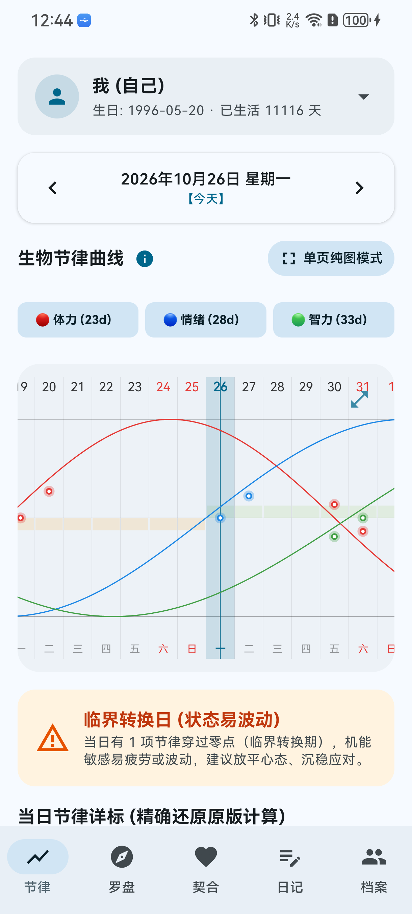
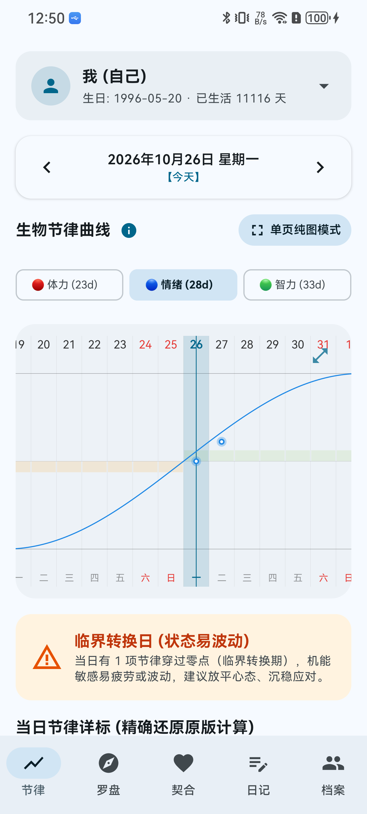
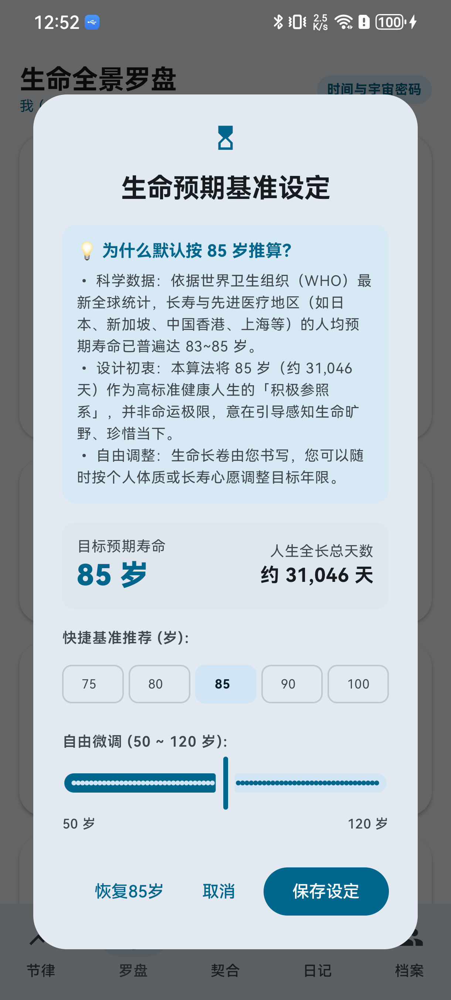
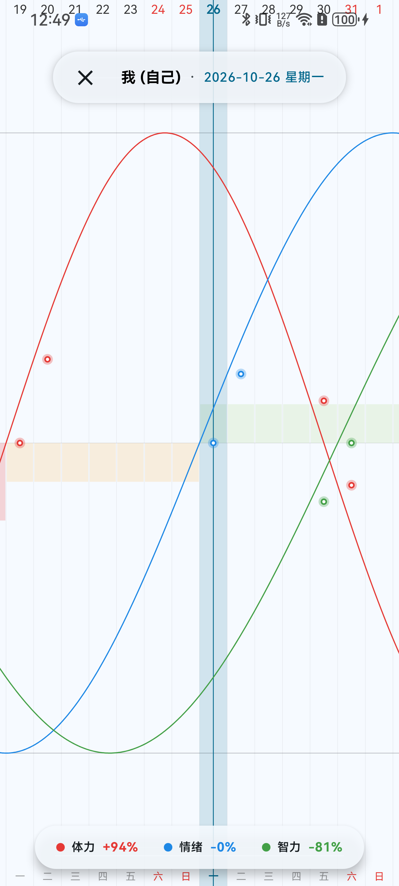
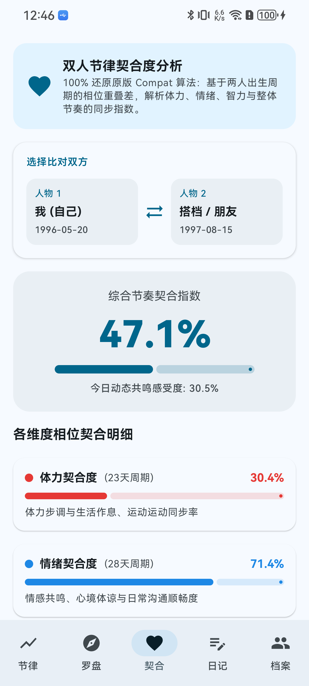
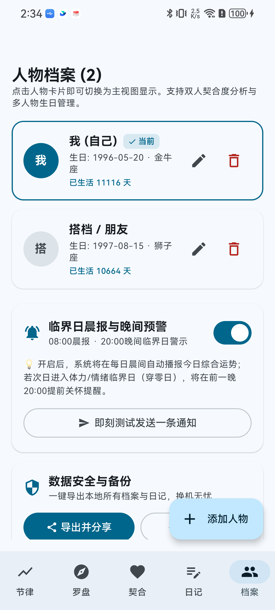
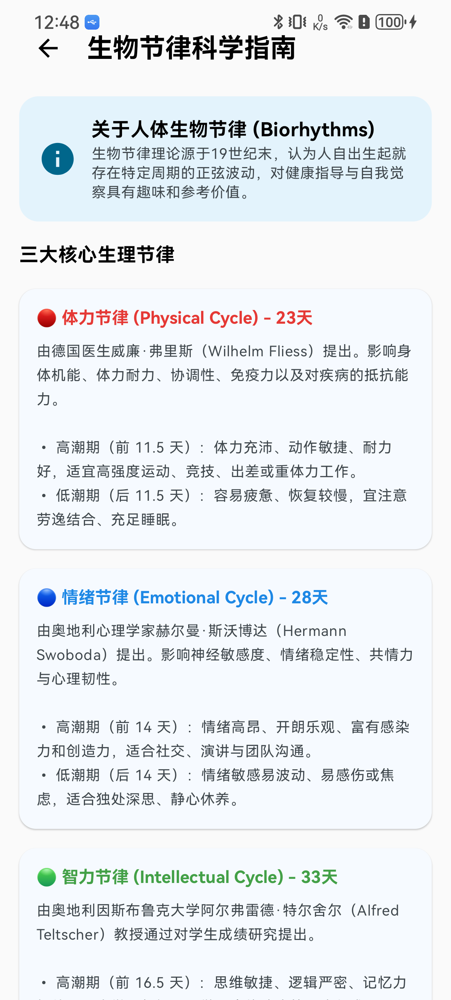

# 🌌 现代人体生物节律 (BioRhythms Modern)

[](https://kotlinlang.org)
[](https://developer.android.com)
[](https://developer.android.com/jetpack/compose)
[](LICENSE)

一款基于经典人体生物周期理论，采用 **Kotlin + Jetpack Compose + Material 3** 全面重构的现代化原生 Android 应用。

本项目对经典生物节律进行深度算法逆向与原生工程化重构：**100% 严谨还原经典三大周期数学模型**，杜绝伪周期，在视觉审美、极客手势交互、多维生命罗盘、跨周期预警通知与桌面微件生态上实现全面进化。

---

## 📸 应用实机截图预览 (Screenshots)

<p align="center">
  
  
  
  
  
</p>

<p align="center">
  
  
  
  
  
</p>

---

## 📱 快速安装体验

* **🏷️ GitHub 官方 Release 页面发布**：[**BioRhythms Modern v5.0.0 发布页**](https://github.com/menggod/bio/releases/tag/v5.0.0)
* **🚀 推荐：正式 Release 安装包（已签名·仅 12MB）**：
  * [GitHub Release 直链下载](https://github.com/menggod/bio/releases/download/v5.0.0/biorhythms-v5.0-release.apk) 或直接下载仓库中的 **[`biorhythms-v5.0-release.apk`](./biorhythms-v5.0-release.apk)**
* **🛠️ 调试测试包**：
  * [GitHub Release 调试包下载](https://github.com/menggod/bio/releases/download/v5.0.0/biorhythms-v5.0-modern.apk) 或直接下载仓库中的 [`biorhythms-v5.0-modern.apk`](./biorhythms-v5.0-modern.apk)
* **系统要求**：Android 8.0（API 26）至 Android 15 / 16+

```bash
# 通过 ADB 快速安装正式 Release 包到设备
adb install -r biorhythms-v5.0-release.apk
```

---

## ✨ 核心特性

### 1. 经典三大生理节律（100% 纯正算法还原）
* **🔴 体力节律（Physical - 23天周期）**：影响肌肉力量、耐力平衡、协调性与机体抵抗力。
* **🔵 情绪节律（Emotional - 28天周期）**：影响神经感受性、情绪稳定性、共情力与心理韧性。
* **🟢 智力节律（Intellectual - 33天周期）**：影响逻辑思维、逻辑分析、反应速度与记忆力。
* **时区与夏令时零误差**：严格基于 `java.time.LocalDate` 计算基准，杜绝夏令时、跨时区与闰年天数漂移。

### 2. 交互式波形图表 Canvas
* **平滑贝塞尔波形**：硬件加速级流畅渲染跌宕起伏的周期波动。
* **双指捏合缩放（Pinch-to-Zoom）**：支持 16dp ~ 44dp 视界无级缩放，既可同屏审视近一个月的宏观趋势，也可放大探查微观走势。
* **长按拖拽十字准星 HUD（Tooltip）**：手指在画布滑动时触发高亮垂线与跟随微晶半透明气泡，实时展示当前日期的具体三维数值（体力/情绪/智力 %）。
* **单周期波形独立筛选**：点击图例切换 🔴体力 / 🔵情绪 / 🟢智力 独立显示，专注于单一周期的波峰波谷分析。
* **微晶光晕临界日**：穿零临界点呼吸闪烁标记，防范身心波动脆弱期。
* **全屏纯净大画幅模式**：一键切换沉浸单页大图，零干扰观览大波形走势。

### 3. 生命全景罗盘（多维哲学与时间印记）
* **生命电量进度**：
  * 精准换算人生电量百分比、已度过天数与剩余探索天数；
  * **科学依据与自定义**：弹窗科普世界卫生组织（WHO）85岁高健康寿命基准，并支持在 50~120 岁间自由调整个人预期寿命，即时联动重算；
  * 统计跟随地球公转太空狂奔里程、心跳搏动总数与万日礼（10,000天）纪念倒计时。
* **各大行星宇宙年龄**：精准换算在水星、金星、火星、木星、土星绕日公转下的真实宇宙年龄。
* **西方毕达哥拉斯生命灵数**：探寻生辰密码中的天赋特质与深层潜能。
* **东方干支哲学（日主元神）**：基于天文儒略日算法解析日柱天干地支、五行意象与性格哲学。

### 4. 临界日智能晨报 / 晚间预警通知
* **晨间播报（08:00）**：播报今日综合精力状态与行动建议；
* **晚间预告（20:00）**：前瞻预警次日“穿零临界日”（如情绪临界日容易急躁、体力临界日抵抗力弱），提醒早做身心调整；
* 支持在“档案与设置”中随时开启/关闭，并提供一键测试发送通知验证系统权限。

### 5. 桌面小部件生态 (Desktop Widgets)
* **4×2 极光微晶玻璃大卡片**：展示头像、三维能量环进度条、临界日状态与今日综合状态；
* **2×2 极简紧凑型小微件**：专为桌面紧凑布局设计，高信息密度呈现三大百分比与核心评语；
* **4 重智能更新保障机制**：
  1. 系统定时 30 分钟轮询保鲜；
  2. 午夜零点（00:00）系统广播监听，跨日自动翻篇；
  3. 跨时区旅行与时间微调自适应；
  4. App 内切换人物或修改资料时毫秒级即时广播刷新。

### 6. 双人相位契合度分析
* 深度计算双方在体力、情绪、智力上的相位差与综合契合指数；
* 实时分析今日共鸣度与智能相处建议。

### 7. 节律日记与自我验证
* 记录每日生活随笔，进行 1~5 星自我精力吻合度打分；
* 自动统计与理论节律的吻合百分比，建立科学的自我觉察习惯。

### 8. 科学科普指南 (InfoScreen)
* 首页顶部及档案底部常设 ⓘ 科学指南直达入口；
* 系统介绍 19 世纪威廉·弗里斯与赫尔曼·斯沃博达的研究起源、正弦波周期物理模型以及高潮期、低潮期与临界日的实用应对策略。

### 9. 数据安全与隐私备份
* **100% 本地存储**：完全无需网络权限，个人生日、档案与私密日记严格保存在设备本地；
* **一键导出备份**：支持生成标准 JSON 备份文件，并调用系统分享面板存储到网盘或即时通讯工具；
* **直接粘贴恢复**：支持从剪贴板一键还原数据，换机迁移零门槛。

---

## 🛠️ 技术架构

* **编程语言**：Kotlin 2.0+ (100% 现代语法与协程)
* **UI 框架**：Jetpack Compose + Material Design 3 (Dynamic Color)
* **架构模式**：MVI / Clean Architecture (Kotlin Coroutines & StateFlow)
* **存储层**：SharedPreferences 本地持久化 + JSON 序列化
* **绘图引擎**：Compose Hardware Canvas (Custom Path & DrawScope, 60/120 FPS 平滑手势)
* **桌面微件**：Android RemoteViews + AppWidgetProvider (双尺寸 4×2 & 2×2)
* **系统通知**：AlarmManager 精确定时 + Android NotificationChannel 规范

---

## 🏗️ 源码构建与运行

需要 JDK 17 及 Android SDK 36：

```bash
# 1. 克隆代码仓库
git clone https://github.com/menggod/bio.git
cd bio/biorhythms

# 2. 执行单元测试验证数学模型
./gradlew testDebugUnitTest

# 3. 编译打包 Debug APK
./gradlew assembleDebug

# 4. 编译打包 Release APK
./gradlew assembleRelease
```

---

## 📜 许可证

本项目采用 [Apache-2.0 License](LICENSE) 开源协议。
